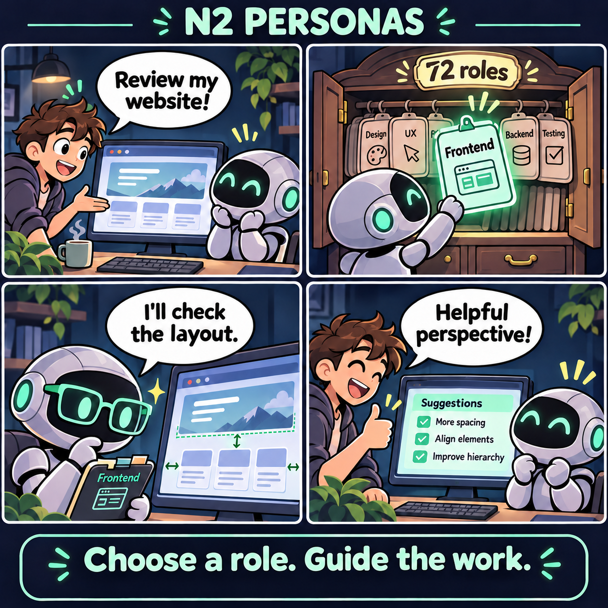
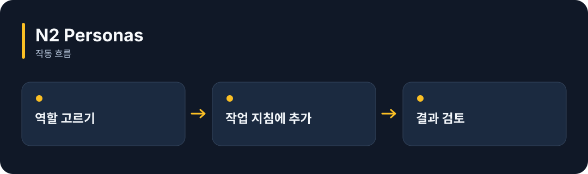

# N2 Personas

**AI에게 맡길 역할을 골라 쓸 수 있는 72개의 지침 모음입니다.**

[](https://github.com/choihyunsus/n2-personas/releases/tag/v1.0.0) [](https://github.com/choihyunsus/n2-personas/blob/main/docs/reference.ko.md) [](https://github.com/choihyunsus/n2-personas/blob/main/LICENSE)

[English](README.md)

<p align="center">
  
</p>

웹 화면 검토를 요청하고 → 역할 지침을 골라 → 다른 관점으로 살펴보고 → 제안을 검토합니다.

기능을 이야기로 표현한 만화입니다. 실제 앱 화면은 아닙니다.

<details>
<summary>동작 흐름 펼쳐 보기</summary>



</details>

## 이런 때 사용하세요

웹 화면 검토, 글쓰기, 자료 분석처럼 작업마다 다른 관점을 요청할 때 활용하세요.

역할 설명을 실제 모델 요청에 넣는 것은 연결한 앱의 몫입니다. 결과의 정확성과 전문성은 작업별로 확인하세요.

## 처음 실행하기

터미널에서 `node --version`을 실행해 Node.js 22 이상인지 확인하세요. 아래 명령은 새 연습 폴더를 만들고 GitHub 배포 파일을 설치합니다. 예제 파일과 DB도 이 폴더에 두면 경로를 따라가기 쉽습니다.

```sh
mkdir n2-personas-demo
cd n2-personas-demo
npm init -y
npm install github:choihyunsus/n2-personas#v1.0.0
```

아래 내용을 `demo.mjs`로 저장하세요. 파일은 방금 설치 명령을 실행한 폴더에 둡니다.

```js
import { listPersonas, getPersona } from 'n2-personas';
console.log(listPersonas().length);
console.log(getPersona('dev/web-frontend').prompt);
```

```sh
node demo.mjs
```

`72`와 프런트엔드 역할 지침이 출력됩니다. 원하는 역할의 문장을 AI 요청에 추가해 사용할 수 있어요.

## Soul과 함께 쓰기

이 모듈은 자체 DB 없이 사용할 수 있습니다. 결과를 기억하려면 연결한 앱에서 Soul의 `n2_kv_save`를 호출해 저장하세요.

## 다음 단계와 상세 안내

[전체 사용 안내](https://github.com/choihyunsus/n2-personas/blob/main/docs/reference.ko.md)에서 실제 앱 연결, API, 지원 범위, 복구 절차와 검증 범위를 확인할 수 있습니다. [배포 파일](https://github.com/choihyunsus/n2-personas/releases/tag/v1.0.0)에는 설치할 버전과 변경 설명이 있습니다.

처음 나오는 용어는 이렇게 읽으면 됩니다. **MCP**는 AI 앱의 도구 연결 방식, **DB**는 저장 파일, **호스트**는 이 모듈을 연결해 실행하는 앱입니다.

사용·재배포 조건은 [라이선스](https://github.com/choihyunsus/n2-personas/blob/main/LICENSE)를 확인하세요. 의존 모듈에는 별도 조건이 적용될 수 있으며, 상업 이용 조건은 상세 안내에 함께 설명되어 있습니다.
