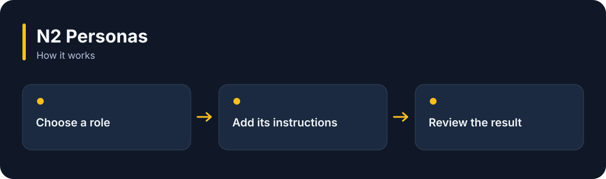

# N2 Personas

**Choose from 72 reusable sets of instructions for the role you want an AI to take.**

[](https://github.com/choihyunsus/n2-personas/releases/tag/v1.0.0) [](https://github.com/choihyunsus/n2-personas/blob/main/docs/reference.md) [](https://github.com/choihyunsus/n2-personas/blob/main/LICENSE)

[한국어](README.ko.md)



## When to use it

Use a different perspective for a website review, a writing task or a data analysis job.

Your app adds the selected instructions to the model request. Check accuracy and expertise against the actual task.

## Try it

Run `node --version` in a terminal and check for Node.js 22 or later. These commands create a fresh practice folder and install the GitHub release. Keep the example file and database in this folder.

```sh
mkdir n2-personas-demo
cd n2-personas-demo
npm init -y
npm install github:choihyunsus/n2-personas#v1.0.0
```

Save the following as `demo.mjs` in the folder where you ran the install command.

```js
import { listPersonas, getPersona } from 'n2-personas';
console.log(listPersonas().length);
console.log(getPersona('dev/web-frontend').prompt);
```

```sh
node demo.mjs
```

`72` and the frontend role instructions appear. Add the chosen instructions to your AI request.

## Using it with Soul

This module works without its own database. To remember its results, have your app save them through Soul’s `n2_kv_save` tool.

## Next steps and reference

The [full reference](https://github.com/choihyunsus/n2-personas/blob/main/docs/reference.md) covers app integration, APIs, supported features, recovery and validation. The [release page](https://github.com/choihyunsus/n2-personas/releases/tag/v1.0.0) contains the installable version and release notes.

A few terms used in the reference: **MCP** connects tools to an AI app, a **database** stores records, and the **host** is the app that connects and runs this module.

Review the [license](https://github.com/choihyunsus/n2-personas/blob/main/LICENSE) for use and redistribution. Dependencies can have their own terms, including commercial-use conditions described in the reference.
